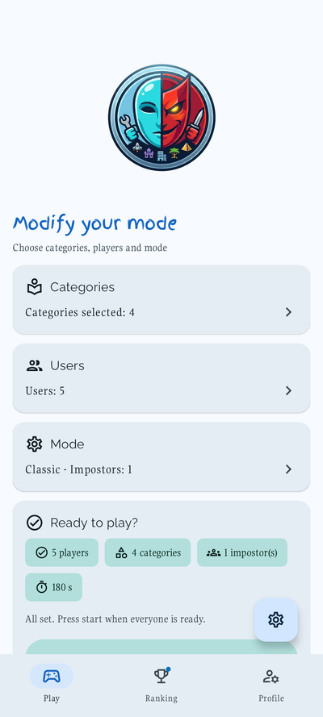
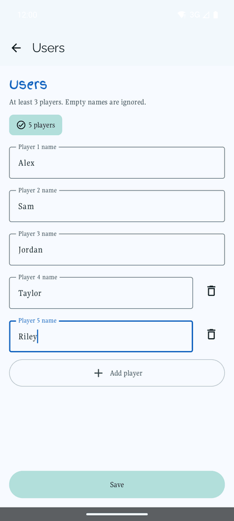
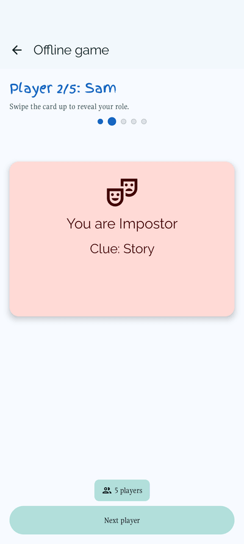
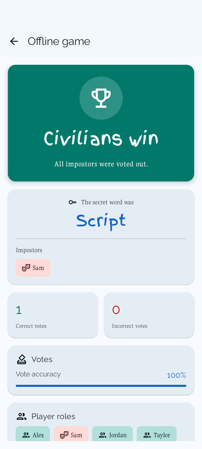

# Omni-Impostor

A **digital party game for groups** built with Kotlin and Jetpack Compose. Players are secretly assigned a word — most share the same word, but one or more are *impostors* assigned a different one. The group debates, votes, and tries to identify the impostor before time runs out.

Built on **multi-module Clean Architecture** with Firebase, Hilt, and Material Design 3.

[](https://play.google.com/store/apps/details?id=es.sebas1705.impostorandroidgame)

<p align="center">
  
  
  
  
</p>

---

## Features

| | |
|---|---|
| Offline party game | Pass-the-phone play with a local word bank (ES/EN) |
| Animated reveal card | 3D flip reveals each player's secret word privately |
| Word categories | 44 categories in a local word bank (ES/EN), stored on the device |
| Ranking system | Local leaderboard with win counts and streaks, stored on the device |
| Google Sign-In + Firebase Auth | Identity management with profile screen |
| Material Design 3 | Dynamic light/dark theme · 3 contrast levels |
| Custom typography | Finger Paint (titles) · Gupter (body) · Raleway (display) |

---

## Tech Stack

| Layer | Technologies |
|---|---|
| UI | Jetpack Compose · Material 3 · Navigation Compose |
| DI | Hilt |
| Data | Firebase Auth · Firestore (clue ratings) · Couchbase Lite (words, ranking) · DataStore · Retrofit and Room modules exist but the game does not use them yet |
| Analytics | Firebase Analytics · Crashlytics |
| Architecture | Multi-module Clean Architecture (`app / core / data / domain / feature`) |
| Quality | Detekt · LeakCanary · Chucker · GitHub Actions CI |

---

## Module Structure

```
app/
core/        ← common · designsystem · resources · ui
data/        ← authentication · couchbase · datastore · files · firestore · repositories · retrofit · room
domain/      ← managers · mappers · models · services · usecases (analytics · auth · game · ranking · opendb · settings)
feature/     ← splash · login · main · home (face · ranking · profile) · offlinegame · settings · debug
```

Full module inventory: [`docs/module-map.md`](docs/module-map.md)

---

## Getting Started

### Prerequisites

- Android Studio Hedgehog or newer
- JDK 21
- A Firebase project with **Authentication** (Google Sign-In) and **Firestore** enabled
- [Doppler CLI](https://docs.doppler.com/docs/install-cli) + access to the `omni-impostor` project

### Setup

1. Clone:
   ```bash
   git clone https://github.com/Sebas1705/Omni-Impostor.git
   cd Omni-Impostor
   ```

2. Bootstrap secrets (requires `doppler login` first):
   ```bash
   doppler setup                    # auto-selects omni-impostor/dev_personal
   bash scripts/setup-secrets.sh    # or .\scripts\setup-secrets.ps1 on Windows
   ```
   This generates `app/secrets.properties`, `app/google-services.json`, and `app/keystore.jks`.

3. Build and run:
   ```powershell
   .\gradlew.bat assembleDevDebug
   ```

### Quality commands

```powershell
.\gradlew.bat detekt
.\gradlew.bat coverageUnitTestAll
.\gradlew.bat dependencyUpdates --no-parallel
```

---

## Game Flow

```
Splash → Login → Home Dashboard
                      ├── Face (setup: categories + players + game mode)
                      │       └── Reveal → Discussion (timer) → Results
                      ├── Ranking
                      ├── Profile
                      └── Settings
```

---

## License

MIT
